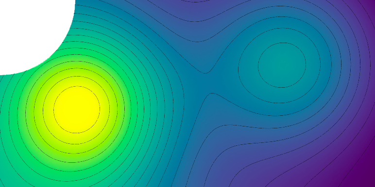
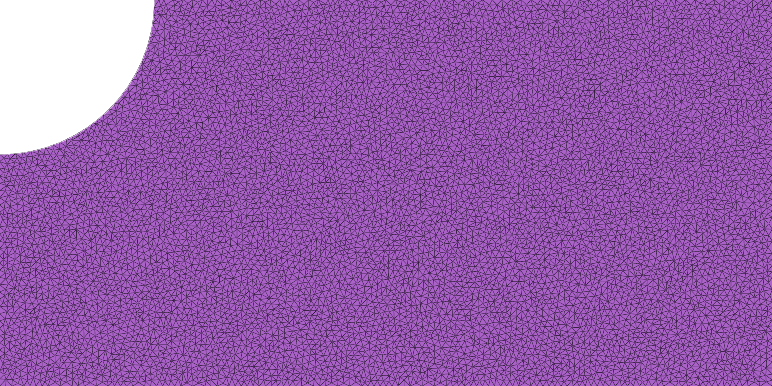

# Your first PolyFEM simulation

This hands-on introduction starts with a complete, downloadable example, explains each part of the input, and then changes the physics and boundary conditions. You can **run PolyFEM without compiling it** if a suitable prebuilt package is available.

**What you will do:** open the PolyFEM desktop application, load a JSON simulation of a plate with a hole, run it using the **Run** button, inspect the output in ParaView, and then try linear elasticity.



## 1. Get PolyFEM

Choose one of these paths:

=== "Download a binary (quickest)"

    PolyFEM's [Artifacts workflow](https://github.com/polyfem/polyfem/actions/workflows/artifacts.yml) packages the executable for **Linux x86-64**, **macOS ARM64**, and **Windows AMD64**.

    1. Open the workflow and choose a **successful run on `main`**. For example, [this successful October 30, 2026 run](https://github.com/polyfem/polyfem/actions/runs/41086941557) contains all three platform packages.
    2. Under **Artifacts**, download the package matching your operating system. GitHub may ask you to sign in.
    3. Extract the Linux `.tar.gz` or Windows `.zip`, or open the macOS `.dmg`. Launch the packaged **PolyFEM desktop application** (`polyfem_app`), using the normal launcher for your platform. The desktop app has **Load JSON**, **Load HDF5**, and **Run** controls.
    4. The command-line `PolyFEM_bin` is a separate option and is not required for the walkthrough.

    !!! note "Workflow artifacts, not tagged releases"
        These packages are built from the project’s `main` branch. They are **CI artifacts** (which can expire), not assets attached to the older [v0.5 GitHub release](https://github.com/polyfem/polyfem/releases/tag/v0.5). Use the latest successful workflow run when the example link expires.

=== "Build from source"

    Building from source is useful when modifying PolyFEM itself or when no prebuilt package matches your platform. You need **CMake 3.25+**, a **C++17 compiler**, Git and an internet connection for initial dependency downloads. Python development headers are also required unless you disable Python support.

    ```sh
    git clone https://github.com/polyfem/polyfem.git
    cd polyfem
    cmake -S . -B build -G Ninja -DCMAKE_BUILD_TYPE=Release
    cmake --build build
    ```

    Ninja is recommended but optional; omit `-G Ninja` if you are using a different generator. See the [up-to-date PolyFEM build instructions](https://github.com/polyfem/polyfem#compilation) for platform-specific notes.

=== "Python"

    PolyFEM also offers a separate Python interface:

    ```sh
    conda install -c conda-forge polyfempy
    ```

    The command-line examples below use the **C++ executable**, not `polyfempy`. For Python examples, see the [Python guide](../python.md) and [Jupyter tutorial](../python_examples.ipynb).

## 2. Download a complete first example

Create an empty directory called `polyfem-first-run` and save **both** files there:

- [`run.json`](run.json) — the ready-to-run configuration (open the link and save the file).
- [`plate_hole.obj`](../img/plate_hole.obj) — the example mesh (download it into the same directory).

Your working directory should contain:

```text
polyfem-first-run/
├── plate_hole.obj
└── run.json
```

!!! important "Keep the files together"
    The configuration contains `"mesh": "plate_hole.obj"`. Running it from the directory containing both files avoids path-resolution surprises.

## 3. Run the simulation in the desktop application

1. Launch the **PolyFEM app** (`polyfem_app`) from the downloaded package. If you compiled from source, make sure the application was enabled with `POLYFEM_WITH_APP=ON` and launch the built app.
2. Click **Load JSON** and select `run.json` from your `polyfem-first-run` directory. The mesh path inside the JSON refers to `plate_hole.obj` in that same directory.
3. Click **Run** to start the solve. The interface displays **Running...** while it is executing; wait for it to finish, and check any displayed errors if the input cannot be loaded.
4. Find the generated output in the configured output directory. This example requests **`result.vtu`** and **`stats.json`**.

The application also has a **Load HDF5** button for bundled inputs, but JSON is simpler for a first exercise.

!!! note "Command-line alternative"
    If you prefer scripting or automation, the separate command-line executable accepts the same example:

    ```sh
    /path/to/PolyFEM_bin --json run.json
    ```

    This is optional for beginners. It is **not** how the desktop application is launched.

### What are we solving?

The *Laplacian* is a scalar PDE. This example uses PolyFEM's `Franke` preset, which provides a convenient test problem without requiring you to manually define forces and boundary values. PolyFEM constructs the finite-element system, solves it, and exports the field for visualization.

## 4. Inspect the results

Install [ParaView](https://www.paraview.org/) and open the generated `result.vtu`.

1. Click **Apply** in ParaView after loading the data.
2. Choose the solution field in the **Coloring** dropdown.
3. Compare the visualization with the reference below.

| Input mesh | Reference solution |
| --- | --- |
|  |  |

For this scalar problem, you are viewing a field on a fixed geometry, not deforming the mesh. The **Warp By Vector** filter becomes useful when you solve displacement-based elasticity problems.

## 5. Understand `run.json`

Here is the complete example, so you can read it alongside the downloaded file:

```json
{
  "geometry": {
    "advanced": { "normalize_mesh": true },
    "mesh": "plate_hole.obj",
    "surface_selection": { "threshold": 1e-7 }
  },
  "materials": { "type": "Laplacian" },
  "preset_problem": { "type": "Franke" },
  "solver": { "linear": { "solver": "Eigen::SparseLU" } },
  "output": {
    "json": "stats.json",
    "paraview": { "file_name": "result.vtu" }
  }
}
```

| Section | Meaning | Try changing |
| --- | --- | --- |
| `geometry` | Load a mesh and optionally normalize its size | Use a different mesh |
| `surface_selection` | Associate boundary primitives with IDs | Change or specify a boundary selection |
| `materials` | Choose the governing PDE/material | `Laplacian` → `LinearElasticity` |
| `preset_problem` | Supply a built-in test problem | Replace with your own boundary conditions |
| `solver` | Select numerical linear solver | Explore other supported solvers |
| `output` | Write data for diagnostics and visualization | Change the output file name |

For every available setting, use the [JSON input guide](../json.md) and the [automatically generated JSON specification](../json_defaults_and_spec.md). The [interactive JSON builder](https://polyfem.github.io/json-builder/) is another way to explore configuration options.

## 6. Change the problem: linear elasticity

Now use the *same mesh* to solve a vector-valued displacement problem.

1. Copy `run.json` to `elasticity.json`.
2. Replace `"materials": { "type": "Laplacian" }` with:

    ```json
    "materials": {
      "type": "LinearElasticity",
      "E": 210000,
      "nu": 0.3
    }
    ```

3. **Remove the entire `preset_problem` section**, including its trailing comma as needed.
4. Add the following **top-level** `boundary_conditions` section:

    ```json
    "boundary_conditions": {
      "neumann_boundary": [
        { "id": 3, "value": [100, 0] }
      ],
      "dirichlet_boundary": [
        { "id": 1, "value": [0, 0], "dimension": [true, false] },
        { "id": 4, "value": [0, 0], "dimension": [false, true] }
      ]
    }
    ```

5. Change the output filename to `elasticity.vtu`, then return to the **desktop app**, click **Load JSON** to select `elasticity.json`, and click **Run** again. You can also run it using `PolyFEM_bin --json elasticity.json` if you prefer the CLI.

**What changed?** In elasticity, the unknown is a *displacement vector*. Neumann conditions prescribe a force/traction; Dirichlet conditions constrain displacement. The `dimension` masks here restrict only one coordinate at each of the two selected boundaries.

These IDs come from the plate-with-hole boundary-tagging convention used in the [full Getting Started tutorial](../tutorials/getting_started.md#boundary-conditions); they are not automatically meaningful for an arbitrary mesh.

!!! tip "Explore boundary conditions visually"
    In ParaView, color the resulting field and use **Warp By Vector** with the displacement field to see the deformation. You may need to adjust the warp scale to make small displacements noticeable.

## 7. Where to go next

- **Time stepping and moving boundary conditions:** the [full Getting Started tutorial](../tutorials/getting_started.md#time-dependent-simulation) introduces `time.dt`, `time.tend`, and time-dependent expressions.
- **Contact and friction:** the [IPC Quick Start Guide](../tutorials/ipc_quick_start_guide/ipc_quick_start_guide.md) begins with two cubes falling onto a plane, then develops stiffness, collision, and time-step variations.
- **Several materials in one scene:** see the [Multi-Material tutorial](../tutorials/multi-material/multi-material.md).
- **Real-world test scenes:** explore the [polyfem-data repository](https://github.com/polyfem/polyfem-data). Its examples are useful as complete configurations, but some refer to meshes and shared JSON files elsewhere in that repository. **Keep their relative paths intact** when running them.

## Troubleshooting

**The app cannot start.** Check that the downloaded package matches your architecture (notably macOS ARM64 versus Intel). The GUI application is `polyfem_app`; `PolyFEM_bin` is the separate CLI executable.

**Cannot open `plate_hole.obj`.** Make sure the mesh was downloaded as a raw OBJ file (not an HTML web page) and lives alongside `run.json`. Run from that directory or use an absolute mesh path.

**The JSON cannot be parsed.** JSON requires commas between entries, double-quoted keys, and no trailing comma after the last property. If you made edits in Step 6, check the transition between the `materials`, `boundary_conditions`, and `solver` blocks.

**The app cannot load the JSON.** Check that `run.json` and the referenced `plate_hole.obj` are available together. The **Load JSON** button expects a JSON configuration, not a mesh file.

**The simulation ran but you cannot see the result.** Search the output directory for `result.vtu`, `elasticity.vtu`, or `stats.json`. Open the VTU file in ParaView and click **Apply**.

**The result doesn't look like the picture.** Check the chosen field and color scale. Elasticity results may need the **Warp By Vector** filter; the Laplacian example does not.
