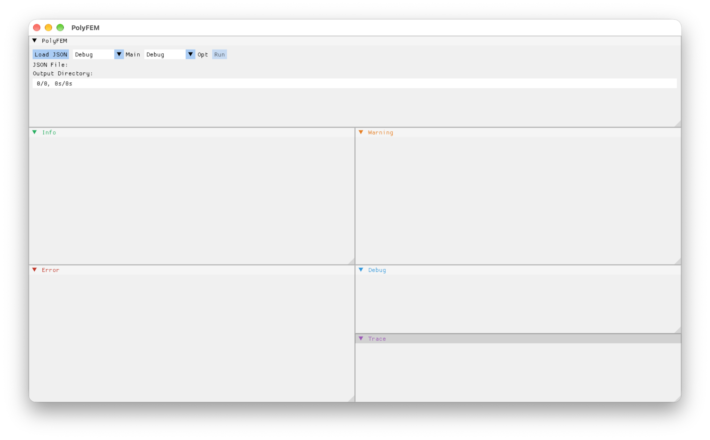
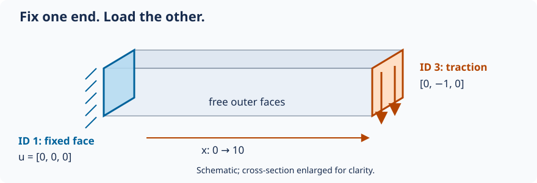
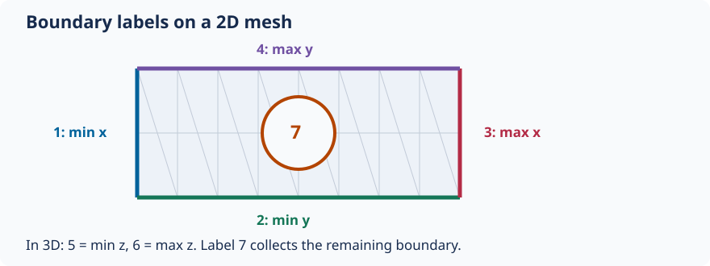
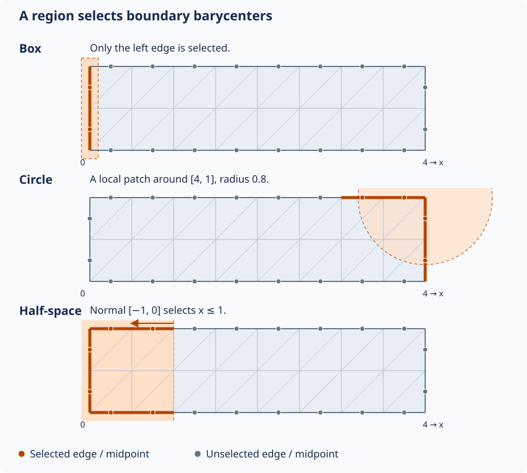

# PolyFEM user guide: from first run to advanced simulations

Start by opening the desktop app and running a complete scalar example. Then solve a **cantilever fixed at one end**, learn how meshes and boundary labels work, and explore materials and finite-element spaces. Dynamics, contact, shared configurations, and coupled physics come later, all on this page.

The examples draw on [polyfem-data](https://github.com/polyfem/polyfem-data) and PolyFEM's tests. The first two exercises include complete configurations and meshes: keep each JSON and its mesh together. Later sections link to complete examples in the data repository.

## 1. Get PolyFEM

=== "Download a binary (quickest)"

    PolyFEM's [Artifacts workflow](https://github.com/polyfem/polyfem/actions/workflows/artifacts.yml) builds desktop packages for **Linux x86-64**, **macOS ARM64**, and **Windows AMD64**.

    1. Open the workflow and choose a **successful run on `main`**.
    2. Under **Artifacts**, download the package matching your operating system and processor. GitHub may ask you to sign in. Artifacts can expire; choose a newer successful run if a download is unavailable.
    3. Extract the Linux `.tar.gz` or Windows `.zip`. On macOS, open the `.dmg` and copy **`polyfem_app.app`** to Applications before opening it.
    4. Launch **`polyfem_app`**, the desktop application. It has **Load JSON** and **Run** controls. The separate `PolyFEM_bin` command-line executable is optional.

=== "Build from source"

    Use a source build if no package matches your platform, or if you want to modify PolyFEM. Follow the [current build instructions](https://github.com/polyfem/polyfem#compilation) for prerequisites and platform-specific details. Enable the desktop application when configuring:

    ```sh
    git clone https://github.com/polyfem/polyfem.git
    cd polyfem
    cmake -S . -B build -DCMAKE_BUILD_TYPE=Release -DPOLYFEM_WITH_APP=ON -DPOLYFEM_WITH_PYTHON=OFF
    cmake --build build
    ```

    Launch `polyfem_app` from the build directory (the `.app` bundle on macOS).

### macOS: allow the app to open

macOS may report that Apple could not verify `polyfem_app.app`. If you downloaded it from the official PolyFEM workflow and trust that download:

1. Try opening the copied application once, then dismiss the verification warning.
2. Open **System Settings → Privacy & Security** and scroll to **Security**.
3. Find the message naming `polyfem_app.app` and click **Open Anyway**.
4. Authenticate if requested, then confirm **Open**.


This is the per-app exception described in [Apple's instructions for opening downloaded apps](https://support.apple.com/102445). A warning that an app **will damage your computer** or contains malware is different; follow Apple's guidance for that warning. Allowing the app to open does not diagnose a model-loading or solver error after launch.

### Get help and report a bug

If installation, loading, or solving fails, check the [PolyFEM issue tracker](https://github.com/polyfem/polyfem/issues) and [report a bug](https://github.com/polyfem/polyfem/issues/new/choose) if needed. Include your operating system and architecture, the workflow run or source commit, the smallest failing JSON and its mesh, and the error text. For a packaged-app problem, mention whether the same input works in a source build.

Before sharing screenshots or logs, **remove usernames, home-directory paths, and private project names**. The app displays full input and output paths.

## 2. Download a complete first example

Create a writable directory called `polyfem-first-run` and save **both** files there:

- [`run.json`](run.json) — the scalar simulation configuration.
- [`plate_hole.obj`](plate_hole.obj) — the mesh, already prepared at the size used by this exercise.

```text
polyfem-first-run/
├── plate_hole.obj
└── run.json
```

The mesh comes from [`standard/plate_hole.obj`](https://github.com/polyfem/polyfem-data/blob/main/standard/plate_hole.obj). The downloaded version is ready to use; the JSON loads its coordinates directly. Keep the mesh beside `run.json`, whose mesh entry is `"mesh": "plate_hole.obj"`.

## 3. Run the simulation in the desktop application



1. Launch **PolyFEM** (`polyfem_app`).
2. Click **Load JSON** and select `run.json`. After loading, the app should show the **JSON File** and **Output Directory** paths.
3. Click **Run** and wait for completion. Check the displayed error/log panels if it fails.
4. Look in the **Output Directory shown by the app** for `result.vtu` and `stats.json`. If no output directory was specified, the GUI creates a run folder under `output/` beside the input.

The screenshot shows the app **before** an input is loaded. An empty JSON File line and `0/0` progress are not evidence of a solver failure; load the configuration first. The app may also offer **Load HDF5** for bundled inputs; start with JSON here.

!!! note "Optional command-line alternative"
    From the directory containing both files, run the separate command-line executable:

    ```sh
    /path/to/PolyFEM_bin --json run.json
    ```

### What are we solving?

The *Laplacian* is a scalar PDE: its solution is one number at each point, rather than a displacement vector. This example uses PolyFEM's `Franke` preset to supply a test problem. PolyFEM assembles the finite-element system, solves it, and exports the field for visualization.

## 4. Inspect the results

Install [ParaView](https://www.paraview.org/) and open `result.vtu` from the app's output directory.

1. Click **Apply** after loading the file.
2. Choose the solution field in the **Coloring** dropdown.
3. Compare with the reference below.

| Input mesh | Reference solution |
| --- | --- |
|  |  |

This scalar field lives on a fixed geometry. In the next exercise, a vector displacement field will describe a bending solid.

## 5. Understand `run.json`

Here is the complete downloaded input:

```json
{
  "geometry": {
    "mesh": "plate_hole.obj",
    "surface_selection": { "threshold": 1e-7 }
  },
  "materials": { "type": "Laplacian" },
  "preset_problem": { "type": "Franke" },
  "solver": { "linear": { "solver": "Eigen::SparseLU" } },
  "output": {
    "json": "stats.json",
    "paraview": { "file_name": "result.vtu" }
  }
}
```

| Section | Meaning |
| --- | --- |
| `geometry.mesh` | Load the mesh in its supplied coordinates |
| `surface_selection` | Assign boundary labels; explained below |
| `materials` | Choose the governing PDE or material model |
| `preset_problem` | Supply this built-in scalar test problem |
| `solver` | Choose a numerical linear solver |
| `output` | Name the visualization and statistics files |

**Try:** change only `output.paraview.file_name`, reload the JSON, and run again. Find the new file in the displayed output directory.

This exercise follows [`standard/plate_hole.json`](https://github.com/polyfem/polyfem-data/blob/main/standard/plate_hole.json), with the mesh prepared in advance and the regression-check settings omitted. The [JSON input guide](../json.md), [generated specification](../json_defaults_and_spec.md), and [interactive JSON builder](https://polyfem.github.io/json-builder/) describe the available options.

## 6. First mechanics example: a cantilever

A **cantilever** is a beam fixed at one end and loaded at the other. Start from a complete new input so the constraints and load are easy to see.

Save these two files together in a writable `polyfem-cantilever` directory:

- [`cantilever.json`](cantilever.json)
- [`bar.msh`](bar.msh)

The mesh is the unchanged [`standard/bar.msh`](https://github.com/polyfem/polyfem-data/blob/main/standard/bar.msh) used by the [heated clamped-bar test](https://github.com/polyfem/polyfem-data/blob/main/standard/thermoelastic_heated_clamped_bar.json). Here we use that geometry for a simpler **static linear-elastic** problem. Its dimensions are **10 × 1 × 1**, with length along x; it is already positioned correctly.



```json
{
  "geometry": {
    "mesh": "bar.msh",
    "surface_selection": { "threshold": 1e-6 }
  },
  "materials": { "type": "LinearElasticity", "E": 20000, "nu": 0.3 },
  "boundary_conditions": {
    "dirichlet_boundary": [ { "id": 1, "value": [0, 0, 0] } ],
    "neumann_boundary": [ { "id": 3, "value": [0, -1, 0] } ]
  },
  "space": { "discr_order": 1 },
  "solver": { "linear": { "solver": "Eigen::SparseLU" } },
  "output": {
    "json": "cantilever-stats.json",
    "paraview": { "file_name": "cantilever.vtu" }
  }
}
```

**Read the setup:** `surface_selection` labels the minimum-x end **1** and maximum-x end **3**. The Dirichlet value `[0, 0, 0]` fixes **all three displacement components** on the left face. The Neumann value `[0, -1, 0]` applies a uniform downward traction to the right face. The remaining faces are free. The load and stiffness are illustrative values in consistent units.

1. In PolyFEM, click **Load JSON**, select `cantilever.json`, and click **Run**.
2. Open `cantilever.vtu` from the displayed output directory in ParaView and click **Apply**.
3. Apply **Warp By Vector** and select the displacement/solution vector. Increase the warp scale if needed to see the small deformation; the beam should bend downward and stay fixed at the left face.
4. Color by displacement magnitude to see the change along the beam. A magnified warp is a visualization aid, not the physical displacement scale.

**Try:** double `E` and rerun with the same load. Linear elasticity should give half the displacement. Then restore `E` and halve the traction: this should also halve the displacement. Keep a copy of each result to compare.

## 7. Meshes: what PolyFEM discretizes

The first example uses **2D triangles**; the cantilever uses **3D tetrahedra**. A mesh divides a domain into elements over which the solution is approximated.

| Input geometry | Finite elements | Typical use |
| --- | --- | --- |
| 2D triangular or quadrilateral mesh | Triangles or quads | A planar PDE or 2D solid |
| 3D tetrahedral or hexahedral volume mesh | Tets or hexes | A volumetric solid or fluid |
| Polygonal / polyhedral mesh | Polygons / polyhedra | Specialized approximation spaces |
| Surface triangle mesh in 3D | Surface triangles | For example, a collision obstacle |

For 3D elasticity, use a **volume mesh** with interior cells. A surface shell alone does not define the volumetric solid in this walkthrough. File extensions are not enough to tell the difference: `.msh` can contain different element types, while an OBJ may describe a planar 2D domain or a surface in 3D.

### Load geometry at the intended size

```json
"geometry": { "mesh": "bar.msh" }
```

Start with the mesh at the correct size and position, and keep length, stiffness, load, density, and time units consistent. For several bodies, `geometry` becomes a list of mesh entries; material-region IDs are explained in the materials section.

To explore element types later, compare [`standard/laplace.json`](https://github.com/polyfem/polyfem-data/blob/main/standard/laplace.json), a 3D cube, with [`standard/laplace_quad.json`](https://github.com/polyfem/polyfem-data/blob/main/standard/laplace_quad.json), a 2D quad mesh. These are different domains, so comparing their errors is not a controlled convergence experiment. The advanced section explains how to run repository examples with shared settings.

## 8. Sidesets, selections, and boundary conditions

A **sideset** groups boundary edges in 2D or boundary faces in 3D under an integer ID. A boundary condition names that ID. The ID is a label, not a coordinate or node number.

A **volume ID** instead labels a region of elements and connects it to a material. Surface IDs and volume IDs are independent: a body with volume ID 2 can have boundary sidesets 1, 3, and 7.

| Setting | What receives labels? | Used for |
| --- | --- | --- |
| `surface_selection` | Boundary edges/faces | Fixed boundaries, tractions, prescribed motion |
| `volume_selection` | Domain elements | Material regions |

### Automatic bounding-box sides

Both downloaded examples use a bounding-box side selector:

```json
"surface_selection": { "threshold": 1e-6 }
```



| ID | Boundary near |
| --- | --- |
| 1 | Minimum x (left) |
| 2 | Minimum y (bottom) |
| 3 | Maximum x (right) |
| 4 | Maximum y (top) |
| 5 / 6 | Minimum / maximum z, in 3D |
| 7 | Remaining boundary edges/faces, such as the hole |

The threshold is a distance tolerance in mesh coordinates. A boundary edge/face is labeled using its **barycenter** (midpoint for an edge, centroid for a triangle). This labels existing boundaries; it does not create cuts or change the mesh.

In the cantilever, ID 1 connects directly to `"dirichlet_boundary": [{ "id": 1, "value": [0, 0, 0] }]`. A zero Dirichlet value means zero **displacement**, while a Neumann value specifies **traction**. A body load belongs in `boundary_conditions.rhs`, rather than on a sideset. Faces without an explicit traction are free in this example.

### Two ways to assign IDs

**Use tags from the mesh or a matching file.** If a supported mesh already carries boundary or material tags, preserve them by leaving the corresponding selection unspecified. Alternatively, supply a tag file:

```json
"geometry": {
  "mesh": "tagged.msh",
  "surface_selection": "surface_tags.txt",
  "volume_selection": "volume_tags.txt"
}
```

These are illustrative names. Tag files must match PolyFEM's ordering of the mesh primitives; they are not lists of arbitrary vertex IDs. [`selection/file.json`](https://github.com/polyfem/polyfem-data/blob/main/selection/file.json) shows a real surface-tag file, `alien.txt`. See the [selection reference](../json.md#selections) for the file format.

**Choose a region geometrically.** A box, sphere, cylinder, or half-space can assign a sideset ID by testing boundary barycenters. This is useful for a local patch that does not follow a whole bounding-box side.



The diagram uses a 2D strip spanning x = 0…4 and y = 0…1. These are **selection fragments**, not complete simulations; use one in the mesh's `geometry` entry:

=== "Box"

    ```json
    "surface_selection": [
      { "id": 10, "box": [[-0.1, -0.1], [0.1, 1.1]] }
    ]
    ```

    This narrow box selects only the left boundary in the illustrated mesh.

=== "Sphere / circle in 2D"

    ```json
    "surface_selection": [
      { "id": 10, "center": [4, 1], "radius": 0.8 }
    ]
    ```

    A circular neighborhood selects a patch near the upper-right corner. In 3D, supply three coordinates to select within a sphere.

=== "Plane / half-space"

    ```json
    "surface_selection": [
      { "id": 10, "point": [1, 0], "normal": [-1, 0] }
    ]
    ```

    The normal points into the selected half-space: here x ≤ 1. It can include parts of several boundary sides, not just edges lying on the plane.

Only edges/faces whose **barycenters** pass the test are selected. Intersecting part of an edge is not enough. The orange dots in the diagram make that distinction visible. On coarse meshes, selection boundaries can look stepped.

For 3D cylindrical neighborhoods, use `p1`, `p2`, and `radius` as in [`selection/cylinder.json`](https://github.com/polyfem/polyfem-data/blob/main/selection/cylinder.json). The actual [`plane`](https://github.com/polyfem/polyfem-data/blob/main/selection/plane.json), [`sphere`](https://github.com/polyfem/polyfem-data/blob/main/selection/sphere.json), and file-selection tests all use the same alien mesh. Compare their `geometry.surface_selection` blocks now; the advanced section explains the shared scene before you run them.

When coordinates should track the object's bounding box, a box selector can use `"relative": true`: its corners then use 0…1 coordinates along each axis. Start with absolute coordinates and a mesh whose dimensions you know. Full options are in the [JSON input guide](../json.md#selections) and [generated specification](../json_defaults_and_spec.md).


## 9. Materials: from one elastic solid to several regions

The `materials` section selects the PDE or constitutive law and its parameters. It is not just a palette or visualization label.

### Start with linear elasticity

```json
"materials": {
  "type": "LinearElasticity",
  "E": 210000,
  "nu": 0.3
}
```

Here `E` is **Young's modulus** (stiffness scale) and `nu` is **Poisson's ratio** (lateral contraction relative to stretching). For time-dependent mechanics, `rho` controls mass density. Physical values must use consistent units.

The `LinearElasticity` model assumes small strains. For larger deformations, use an appropriate nonlinear model instead:

```json
"materials": {
  "type": "NeoHookean",
  "E": 1000000,
  "nu": 0.4,
  "rho": 1000
}
```

This is a valid example of a **compressible Neo-Hookean** material entry. It does **not** alone define a full simulation: geometry, loads, constraints, and possibly time settings still matter.

### Which material family should I choose?

| Model | When to consider it |
| --- | --- |
| `Laplacian`, `Helmholtz` | Scalar PDEs / simple numerical examples |
| `LinearElasticity` | Small-displacement solids |
| `SaintVenant` | Geometrically nonlinear elasticity with a simple constitutive model |
| `NeoHookean` | Finite-deformation hyperelastic solids |
| `MooneyRivlin` and Ogden variants | More specialized hyperelastic models requiring their own parameters |
| `HGOFiber`, `HGODispersion`, `ActiveFiber` | Anisotropic or active-fiber material models |
| `Stokes`, `NavierStokes` | Incompressible fluid flow; mixed spaces and fluid parameters are required |
| `NavierStokesFSI` | Coupled fluid–structure interaction; **advanced**, with several coupled fields |
| `ThermoElasticity` | Coupled displacement and temperature fields |

This is a **guided subset**, not a list of interchangeable options. Each model has its own **required parameters** and mathematical assumptions. See [formulations](../details/formulations.md) and the [generated material specification](../json_defaults_and_spec.md) before switching a real application.

### Multiple materials: connect volume IDs to material IDs

A scene can contain several material regions:

```json
"geometry": [
  { "mesh": "stiff_part.msh", "volume_selection": 1 },
  { "mesh": "soft_part.msh", "volume_selection": 2 }
],
"materials": [
  { "id": 1, "type": "NeoHookean", "E": 1e8, "nu": 0.4, "rho": 2000 },
  { "id": 2, "type": "NeoHookean", "E": 1e6, "nu": 0.4, "rho": 1000 }
]
```

This is a **configuration fragment**, not a runnable scene: both meshes must exist and you need suitable boundary conditions. Notice the correspondence between `volume_selection: 1` and `materials[0].id: 1`, and similarly for ID 2.

**Try it:** on a multi-body model, change one material's `E` by a factor of 10 while keeping everything else fixed. Compare the displacement field and force response. If you want the complete, documented workflow (including mesh generation and assignment of region IDs), continue with [Simulating Multiple Materials in a Single Mesh](../tutorials/multi-material/multi-material.md).

!!! example "From the test suite: one mesh with multiple material IDs"
    [`multi-material/stretch-cubes.json`](https://github.com/polyfem/polyfem-data/blob/main/multi-material/stretch-cubes.json) uses a tagged volume mesh (`cubes_v41.msh`) and three `materials` entries, with IDs 1, 2, and 3. It also uses geometric boxes to select the **left and right boundary regions**, and prescribed motion to stretch the object.

    **Inspect in order:** the mesh file and its *volume IDs* → `materials[].id` → `surface_selection` → `boundary_conditions`. The same integers may appear in different roles, but volume IDs choose material regions while surface IDs choose boundary regions.

    **Try:** make the middle material stiffer by changing only its `E`. Keep the original file and mesh in their repository directory. For the mesh-generation procedure, follow the [existing multi-material tutorial](../tutorials/multi-material/multi-material.md).
## 10. Finite-element spaces: separate geometry, approximation, and physics

An FEM computation involves at least three choices:

1. **Mesh:** how the domain is split into elements (triangles, quads, tets, hexes, etc.).
2. **Approximation space:** the shape functions and number/location of degrees of freedom (for example, linear versus quadratic Lagrange).
3. **Physics/material:** which equations the degrees of freedom satisfy (for example, Laplacian versus elasticity).

The last two are **not the same thing**. You can solve the same elasticity model on the same mesh using different approximation orders, or solve different physics using the same FE space.

### Polynomial degree: P1 versus P2

The easiest experiment is to keep the input and change one field:

```json
"space": {
  "discr_order": 1
}
```

Then try:

```json
"space": {
  "discr_order": 2
}
```

The order controls the **finite-element approximation**, not the material law. Degree 1 generally means a piecewise-linear solution on simplicial elements; degree 2 adds additional degrees of freedom and can resolve more variation on the same mesh, at greater assembly/solve cost.

**Experiment:** solve the same cantilever problem at orders 1 and 2. Compare tip displacement, degrees of freedom, and runtime *without changing the mesh or physics*. For an accuracy study, also compare against a refined reference solution; the cantilever input does not supply an exact solution. A smoother ParaView image alone does not establish greater accuracy.

!!! example "From the test suite: compare element order"
    [`standard/laplace_3d_b2.json`](https://github.com/polyfem/polyfem-data/blob/main/standard/laplace_3d_b2.json) explicitly chooses `"basis_type": "Bernstein"` and `"discr_order": 2`. For a P1/P2 experiment on a single problem, duplicate the cantilever input and change only `space.discr_order`.

    **Try:** compare the number of degrees of freedom, solve time, and solution/error statistics. When comparing separate `polyfem-data` files, first check whether they also changed the **mesh order** or refinement level.
### Basis families

The current JSON specification exposes:

```json
"space": {
  "discr_order": 2,
  "basis_type": "Lagrange"
}
```

| Basis | Interpretation / restriction |
| --- | --- |
| `Lagrange` | Standard nodal finite-element basis; good default |
| `Spline` | Spline-based basis on supported quadrilateral/hexahedral discretizations |
| `Serendipity` | Reduced-DOF polynomial family on supported quadrilateral/hexahedral meshes |
| `Bernstein` | Bernstein basis option (check mesh/feature compatibility before using) |

For **polygonal** elements, PolyFEM has a separate `poly_basis_type` selector. Available names in the current specification include `MFSHarmonic`, `MeanValue`, and `Wachspress`. Those are specialized approximation constructions: they are not simply different names for P1.

The `space.use_p_ref` option allows geometry-dependent **a priori p-refinement**. It is a separate concept from simply increasing a global `discr_order`. For background, see the [technical formulations](../details/formulations.md) and PolyFEM's [Decoupling Simulation Accuracy from Mesh Quality work](https://github.com/polyfem/polyfem).

!!! example "From the test suite: spline and polygonal choices"
    The [`standard/laplace_spline.json`](https://github.com/polyfem/polyfem-data/blob/main/standard/laplace_spline.json) configuration uses a quadrilateral mesh and `space.basis_type: "Spline"`. The [`standard/laplace_mv.json`](https://github.com/polyfem/polyfem-data/blob/main/standard/laplace_mv.json) and [`standard/laplace_ws.json`](https://github.com/polyfem/polyfem-data/blob/main/standard/laplace_ws.json) files instead use a polygon mesh with Mean Value and Wachspress `poly_basis_type` options.

    **Try:** compare the two polygon examples first: their configurations have the same mesh and preset, so the polygonal basis is the meaningful change. Then look at the quadrilateral spline example as a separate basis-family demonstration.
### Mixed formulations have multiple fields

Not every simulation has a single scalar or displacement vector as its unknown. For example, incompressible flow solves for both **velocity** and **pressure**. Fluid–structure interaction can also include solid displacement and ALE mesh displacement. In those cases, the input material and coupled problem configuration refer to **space IDs** for the different fields; using only a single `discr_order` is not a complete mixed formulation setup.

!!! warning "Don't guess a coupled setup"
    A working `NavierStokesFSI` example needs more than changing `materials.type`. It has required field-space IDs, geometry IDs, viscosity, and nested material choices. Start from a compatible **tested configuration** and consult the [generated JSON specification](../json_defaults_and_spec.md).

### Mesh order is not necessarily solution order

A curved/high-order geometric map describes **where the elements are in physical space**. The `space.discr_order` describes **how the unknown field is approximated**. PolyFEM supports separating these decisions in supported cases. Increasing the solution order does not automatically repair a poorly resolved geometric boundary; conversely, a curved mesh can represent geometry well without forcing the solution space to the same order.

## 11. Advanced input: shared configurations and geometry operations

The downloaded scalar and cantilever examples are complete inputs. Larger repository scenes often reuse settings or position several objects. Learn these features once the simpler cases work.

### Run complete examples from the data repository

Download or clone [polyfem-data](https://github.com/polyfem/polyfem-data) and keep its directory structure intact. A small JSON may depend on other JSONs, meshes, or tag files elsewhere in that tree. Open the original example with **Load JSON**, then **Run**. Regression files may also contain `tests` entries for automated accuracy checks; those are not required in your own input.

### Read inherited configurations: `common` and `patch`

[`standard/neohookean.json`](https://github.com/polyfem/polyfem-data/blob/main/standard/neohookean.json) supplies a material and inherits the rest of its scene:

```json
{
  "common": "elastic_common.json",
  "materials": { "type": "NeoHookean", "id": 1, "E": 20000, "nu": 0.3 }
}
```

Read [`elastic_common.json`](https://github.com/polyfem/polyfem-data/blob/main/standard/elastic_common.json) for geometry, constraints, and solver settings, then its parent [`common.json`](https://github.com/polyfem/polyfem-data/blob/main/standard/common.json) for output settings. Downloading only the top-level JSON is insufficient. The selection tests similarly share [`selection/main.json`](https://github.com/polyfem/polyfem-data/blob/main/selection/main.json); its sideset IDs 1 and 3 connect to the regions selected in each child input.

Some examples apply a JSON **`patch`** to a baseline. [P2 ball bounce](https://github.com/polyfem/polyfem-data/blob/main/contact/examples/3D/higher-order/ball-bounce/P2.json) uses JSON Patch operations to replace the mesh and FE order relative to P1. Inspect both files and keep the parent resources available. For an early experiment, editing a copy of a complete input is easier to follow.

### Read material comparisons in context

!!! example "From the test suite: change the law, not the domain"
    Read [`standard/hooke.json`](https://github.com/polyfem/polyfem-data/blob/main/standard/hooke.json), [`standard/saint_venant.json`](https://github.com/polyfem/polyfem-data/blob/main/standard/saint_venant.json), and [`standard/neohookean.json`](https://github.com/polyfem/polyfem-data/blob/main/standard/neohookean.json). The first two use a cube and the `ElasticExact` preset; Neo-Hookean inherits the displacement-controlled `elastic_common.json` baseline.

    **Important:** because these inputs do not all have identical boundary conditions, they are examples of material configuration, **not** an apples-to-apples quantitative constitutive-model comparison. To isolate a material law, hold geometry, loads, and constraints fixed and change the material in a copy of one runnable configuration.

    For specialized materials, [`standard/hooke_anisotropic.json`](https://github.com/polyfem/polyfem-data/blob/main/standard/hooke_anisotropic.json) supplies anisotropic elasticity parameters, while [`standard/active-fiber.json`](https://github.com/polyfem/polyfem-data/blob/main/standard/active-fiber.json) builds a composite with `MaterialSum`, `NeoHookean`, `VolumePenalty`, and `ActiveFiber`. Read them after the isotropic cases.

### Positioning geometry and changing scale

For scenes that need object placement, `transformation` can scale or translate a mesh without editing its file:

```json
"geometry": {
  "mesh": "part.msh",
  "transformation": {
    "scale": [1, 2, 1],
    "translation": [0, 0.5, 0]
  }
}
```

This is a fragment; supply the mesh and remaining simulation settings. Geometric selection runs on the positioned geometry, so moving an object may require changing absolute selection coordinates. With multiple bodies, each geometry entry can have its own placement and material-region ID; the [sphere–mat example](https://github.com/polyfem/polyfem-data/blob/main/contact/examples/3D/large-ratios/sphere-mat.json) demonstrates this.

`geometry.advanced.normalize_mesh` rescales a mesh to a standard size. This is useful in some numerical tests, but it changes physical dimensions and therefore the interpretation of loads and material parameters. The beginner downloads already have the intended geometry; no such operation is needed there.

### Partial displacement constraints

Some mechanical setups prescribe only one component, using a `dimension` mask. That is useful for rollers or symmetry conditions; see the [detailed boundary-condition tutorial](../tutorials/getting_started.md#boundary-conditions). The cantilever instead fixes the whole displacement vector on its clamped face, so it needs no mask.

## 12. Time-dependent simulations: motion and integration

For transient problems, the top-level `time` section determines the simulated interval and time-stepping scheme. A material's density and the problem's initial conditions become especially important. The UI still follows the same workflow: **Load JSON → Run**, but output often becomes a time sequence instead of one VTU.

Start with these actual tests:

- [`interpolation/linear_ramp.json`](https://github.com/polyfem/polyfem-data/blob/main/interpolation/linear_ramp.json) gives boundary IDs 1 and 3 prescribed displacement values, with **different linear-ramp intervals**. It inherits the rest of the scene from `interpolation/main.json`. This demonstrates that *how* a displacement changes over time is separate from *which* boundary receives it.
- [`time-int/euler.json`](https://github.com/polyfem/polyfem-data/blob/main/time-int/euler.json) and [`time-int/newmark.json`](https://github.com/polyfem/polyfem-data/blob/main/time-int/newmark.json) both inherit `time-int/main.json`; they choose `ImplicitEuler` and `ImplicitNewmark` respectively.

```json
"time": {
  "integrator": "ImplicitEuler",
  "tend": 0.1,
  "time_steps": 10
}
```

**Try:** compare the two integrator configurations without editing them first. Then change the time-step count *in a copy*, keeping total simulated time fixed. Compare trajectory/output across steps; do not equate a difference in numerical damping with a material effect.

For a more visual prescribed-motion example, inspect [`time-bc/walking-elephant.json`](https://github.com/polyfem/polyfem-data/blob/main/time-bc/walking-elephant.json). It uses spatial selections and time-dependent boundary motion on an elephant mesh.

## 13. Contact: two bodies and a barrier

Contact is more than two overlapping meshes: the objects must be represented by appropriate geometry, a constitutive model must define their motion, and **collision/contact** must be configured.

Start with [`contact/examples/3D/unit-tests/2-cubes.json`](https://github.com/polyfem/polyfem-data/blob/main/contact/examples/3D/unit-tests/2-cubes.json). It has two cube meshes positioned at different heights, a fixed boundary selection on the lower one, gravity as `rhs`, and a time-dependent solve. Its `common` file supplies shared contact settings; inspect that too.

Next look at [`contact/examples/3D/large-ratios/sphere-mat.json`](https://github.com/polyfem/polyfem-data/blob/main/contact/examples/3D/large-ratios/sphere-mat.json), where the sphere and the mat have **different volume IDs and different Neo-Hookean parameters**. The mat boundaries also move with expressions involving `t`.

**Read in order:** `geometry` (objects and transforms) → `volume_selection` (body/material IDs) → `surface_selection` (prescribed boundaries) → `materials` → `contact` and `time`. Run from the intact data tree; both scenes refer to external meshes and shared settings.

For friction, changing time steps, and codimensional obstacles, the [IPC Quick Start Guide](../tutorials/ipc_quick_start_guide/ipc_quick_start_guide.md) goes much deeper.

## 14. Mixed spaces and coupled physics

A scalar Laplace problem has one unknown; incompressible solids and fluids have **more than one field**. The JSON assigns **FE space IDs**, which are distinct from material-body IDs and boundary sideset IDs.

The [`standard/stokes_static.json`](https://github.com/polyfem/polyfem-data/blob/main/standard/stokes_static.json) example uses velocity in space 0 and pressure in space 1:

```json
"materials": {
  "type": "Stokes",
  "viscosity": 100,
  "velocity_space_id": 0,
  "pressure_space_id": 1
},
"space": {
  "discr_order": [
    { "fe_space": 0, "order": 2 },
    { "fe_space": 1, "order": 1 }
  ]
}
```

Those are **Taylor–Hood-style P2/P1** choices for this example—not different materials, and not two different meshes. [`standard/incompressible.json`](https://github.com/polyfem/polyfem-data/blob/main/standard/incompressible.json) uses analogous displacement/pressure space IDs for incompressible elasticity.

More advanced combinations are represented by:

- [`standard/thermoelastic_heated_clamped_bar.json`](https://github.com/polyfem/polyfem-data/blob/main/standard/thermoelastic_heated_clamped_bar.json): separate displacement and temperature fields, each with its own boundary conditions or right-hand sides.
- [`standard/navier_stokes_transient.json`](https://github.com/polyfem/polyfem-data/blob/main/standard/navier_stokes_transient.json): transient fluid flow with velocity and pressure.
- [`standard/navier_stokes_fsi_simple_square.json`](https://github.com/polyfem/polyfem-data/blob/main/standard/navier_stokes_fsi_simple_square.json): a coupled fluid–structure interaction setup with velocity, pressure, ALE mesh displacement, and solid displacement spaces. It also distinguishes **fluid and solid geometry IDs**.

**Try:** in the FSI file, find each `*_space_id`, then locate its matching entry under `space.discr_order`. Identify the `fe_space` used by each boundary condition. Do **not** attempt to turn a single-field elasticity input into FSI just by changing `materials.type`.

These coupled examples are a reading path first; run them only once the simpler configurations work and you are comfortable interpreting their mesh dependencies, convergence settings, and output.

## 15. Suggested practice sequence

Use real `polyfem-data` files as your starting point. Begin with the complete cantilever download; then use repository examples, keeping their parent configurations, meshes, and resource files available.

| Exercise | Start from | One change to study |
| --- | --- | --- |
| A. Change stiffness | [Cantilever](cantilever.json) | Double `E` with the same load; compare displacement |
| B. Change resolution | [Cantilever](cantilever.json) | Increase `space.discr_order`; compare displacement and cost |
| C. Change boundary labeling | [Alien plane selection](https://github.com/polyfem/polyfem-data/blob/main/selection/plane.json) | Compare with sphere or file selection; inspect affected sidesets |
| D. Change a material region | [Stretching cubes](https://github.com/polyfem/polyfem-data/blob/main/multi-material/stretch-cubes.json) | Change only middle-region `E` |
| E. Change time integration | [Euler](https://github.com/polyfem/polyfem-data/blob/main/time-int/euler.json) | Compare its inherited scene with [Newmark](https://github.com/polyfem/polyfem-data/blob/main/time-int/newmark.json) |
| F. Change FE basis | [Polygonal Mean Value](https://github.com/polyfem/polyfem-data/blob/main/standard/laplace_mv.json) | Compare with [Wachspress](https://github.com/polyfem/polyfem-data/blob/main/standard/laplace_ws.json) |
| G. Identify mixed fields | [Stokes](https://github.com/polyfem/polyfem-data/blob/main/standard/stokes_static.json) | Trace `velocity_space_id`, `pressure_space_id` and FE orders |

The goal is to explain **why** the result changed. If two cases also use different meshes, boundary conditions, or solver settings, they are not a controlled single-parameter comparison.

## 16. Where to go next

- **Time stepping and moving boundary conditions:** the [full Getting Started tutorial](../tutorials/getting_started.md#time-dependent-simulation) introduces `time.dt`, `time.tend`, and time-dependent expressions.
- **Contact and friction:** the [IPC Quick Start Guide](../tutorials/ipc_quick_start_guide/ipc_quick_start_guide.md) begins with two cubes falling onto a plane, then develops stiffness, collision, and time-step variations.
- **Several materials in one scene:** see the [Multi-Material tutorial](../tutorials/multi-material/multi-material.md).
- **Real-world test scenes:** explore the [polyfem-data repository](https://github.com/polyfem/polyfem-data). Its examples are useful as complete configurations, but some refer to meshes and shared JSON files elsewhere in that repository. **Keep their relative paths intact** when running them.

## Troubleshooting

**The app cannot start.** On macOS, follow the [Gatekeeper instructions above](#macos-allow-the-app-to-open) for the verification warning. Check that the downloaded package matches your architecture (notably macOS ARM64 versus Intel). The GUI application is `polyfem_app`; `PolyFEM_bin` is the separate CLI executable.

**Cannot open a mesh.** Make sure you downloaded the linked mesh file, not a GitHub HTML page, and kept its name unchanged beside the JSON. The scalar input expects `plate_hole.obj`; the cantilever expects `bar.msh`.

**The JSON cannot be parsed.** JSON requires commas between entries, double-quoted keys, and no trailing comma after the last property. After an edit, check the commas between the `materials`, `boundary_conditions`, and `solver` blocks.

**The app cannot load the JSON.** Keep `run.json` with `plate_hole.obj`, or `cantilever.json` with `bar.msh`. The **Load JSON** button expects a JSON configuration, not a mesh file.

**The simulation ran but you cannot see the result.** Use the Output Directory shown by the app and look for `result.vtu`, `cantilever.vtu`, or the corresponding statistics JSON. Open the VTU file in ParaView and click **Apply**.

**The result doesn't look like the picture.** Check the chosen field and color scale. Elasticity results may need the **Warp By Vector** filter; the Laplacian example does not.
