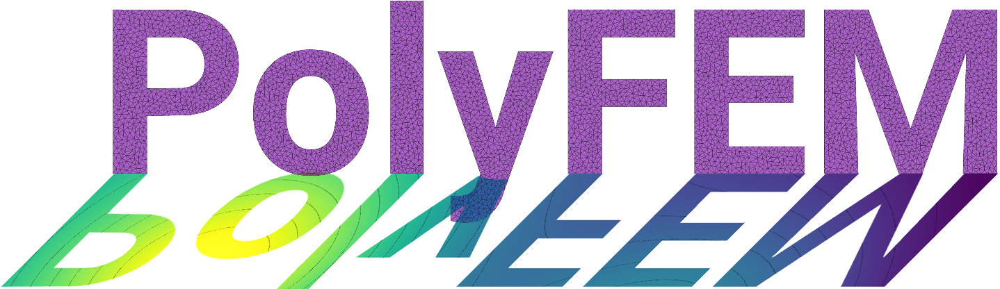

PolyFEM
=======

*A polyvalent C++ and Python FEM library.*



!!! tip "New to PolyFEM? Start with a working example"
    **[Run your first PolyFEM simulation](guide/first-simulation.md)** — a short, step-by-step introduction to building PolyFEM, running a sample problem, and inspecting its output.

    Already familiar with finite elements? Jump to the [full Getting Started tutorial](tutorials/getting_started.md), [JSON input guide](json.md), or [generated JSON specification](json_defaults_and_spec.md).


PolyFEM is a simple C++ and Python finite element library. We provide a wide set of common PDEs including:

 - Laplace
 - Helmholtz
 - Linear Elasticity
 - St. Venant–Kirchhoff Elasticity
 - Neo-Hookean Elasticity
 - Stokes
 - Navier–Stokes

PolyFEM simplicity lies in the interface: just pick a problem, select some boundary condition, and solve. No need to construct complicated function spaces, or learn a new scripting language: everything is set-up trough a [JSON interface](json.md) or through the [Setting class](polyfempy_doc.md) in python.


For instance, PolyFEM seamlessly integrates quad/hexes and tri/tets of order up to 4, and integrates state-of-the-art techniques such as the adaptive $p$-refinement presented in "Decoupling Simulation Accuracy from Mesh Quality" or the spline and polygonal bases in "Poly-Spline Finite-Element Method".

The library is actively used in our research so expect frequent updates, fixes, and new features!

News
----

Recent developments from the [PolyFEM project](https://github.com/polyfem/polyfem). For development activity beyond these highlights, see the [commit history](https://github.com/polyfem/polyfem/commits/main/) and [pull requests](https://github.com/polyfem/polyfem/pulls).

- **November 2, 2026 — JSON builder added to the documentation.** The website navigation now includes a JSON builder page. [Website change](https://github.com/polyfem/polyfem.github.io/pull/10).
- **July 29, 2026 — Fluid–structure interaction (FSI) support.** PolyFEM merged a coupled Navier–Stokes/solid mechanics implementation, including interface coupling forms and associated tests. [Pull request #525](https://github.com/polyfem/polyfem/pull/525).
- **October 30, 2026 — Legacy-code cleanup.** The `no-legacy` changes were merged into PolyFEM. [Pull request #555](https://github.com/polyfem/polyfem/pull/555).
- **October 28, 2026 — Macro strain moved to the variational-form implementation.** Periodic macro-strain simulations now route through the nonlinear-elasticity variational form. [Pull request #546](https://github.com/polyfem/polyfem/pull/546).
- **October 23, 2026 — Extremum Sum Potential integrated.** A new contact formulation based on Extremum Sum Proximity Potential was merged. [Pull request #542](https://github.com/polyfem/polyfem/pull/542).

See [earlier announcements](news-archive.md) or the [v0.5 release](https://github.com/polyfem/polyfem/releases/tag/v0.5) for historical information.

PolyFEM in C++
----


For more details refer to the [C++ section](cxx_index.md)


### Compilation

All the C++ dependencies required to build the code are included. It should work on Windows, macOS, and Linux, and it should build out-of-the-box with CMake:

```sh
mkdir build
cd build
cmake ..
make -j4
```

### Usage

The main executable, `./PolyFEM_bin`, can be called as a command-line interface. Simply run:

```sh
./PolyFEM_bin --help
```

PolyFEM in Python
------

[](https://anaconda.org/conda-forge/polyfempy)
[](https://anaconda.org/conda-forge/polyfempy)
[](https://anaconda.org/conda-forge/polyfempy)
[](https://mybinder.org/v2/gh/polyfem/polyfem.github.io.git/docs?filepath=docs%2Fpython_examples.ipynb)

For more details refer to the [Python section](python.md)

### Installation

We are making efforts to provide a simple python interface to Polyfem.

For doing so, we are maintaining a *conda* package that can be easily installed [https://anaconda.org/conda-forge/polyfempy](https://anaconda.org/conda-forge/polyfempy).

```sh
conda install -c conda-forge polyfempy
```

### Usage
Simply import the package!

```python
import polyfempy
```

PolySolve
---------

PolyFEM heavily depends on external libraries for solving linear systems. If you need a linear system wrapper based on Eigen (but do not need the finite element setup) you use [PolySolve](polysolve.md).

Citation
--------

If you use PolyFEM in your project, please consider citing our work:

```bibtex
@misc{polyfem,
  author = {Teseo Schneider and Jérémie Dumas and Xifeng Gao and Denis Zorin and Daniele Panozzo},
  title = {{PolyFEM}},
  howpublished = "\url{https://polyfem.github.io/}",
  year = {2019},
}
```

```bibtex
@article{Schneider:2019:PFM,
  author = {Schneider, Teseo and Dumas, J{\'e}r{\'e}mie and Gao, Xifeng and Botsch, Mario and Panozzo, Daniele and Zorin, Denis},
  title = {Poly-Spline Finite-Element Method},
  journal = {ACM Trans. Graph.},
  volume = {38},
  number = {3},
  month = mar,
  year = {2019},
  url = {http://doi.acm.org/10.1145/3313797},
  publisher = {ACM}
}
```

```bibtex
@article{Schneider:2018:DSA,
    author = {Teseo Schneider and Yixin Hu and Jérémie Dumas and Xifeng Gao and Daniele Panozzo and Denis Zorin},
    journal = {ACM Transactions on Graphics},
    link = {},
    month = {10},
    number = {6},
    publisher = {Association for Computing Machinery (ACM)},
    title = {Decoupling Simulation Accuracy from Mesh Quality},
    volume = {37},
    year = {2018}
}
```

Acknowledgments & Funding
--------
The software is being developed in the [Geometric Computing Lab](https://cims.nyu.edu/gcl/index.html) at NYU Courant Institute of Mathematical Sciences and the University of Victoria, Canada.


This work was partially supported by:

* the NSF CAREER award 1652515
* the NSF grant IIS-1320635
* the NSF grant DMS-1436591
* the NSF grant 1835712
* the SNSF grant P2TIP2_175859
* the NSERC grant RGPIN-2021-03707
* the NSERC grant DGECR-2021-00461
* Adobe Research
* nTopology


License
-------

The code of PolyFEM itself is licensed under [MIT License](https://github.com/polyfem/polyfem/blob/main/LICENSE). However, please be mindful of third-party libraries which are used by PolyFEM and may be available under a different license.
